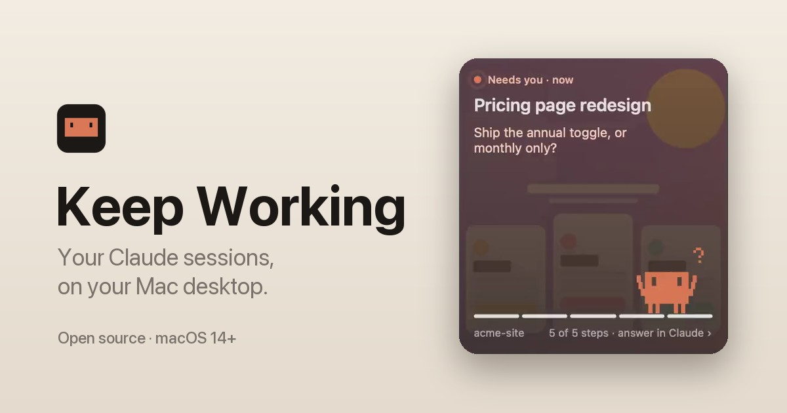

# Keep Working



Your Claude sessions, on your Mac desktop. A little character walks the steps while Claude works, snaps a
photo when a new image arrives, waves when Claude needs you, and celebrates when it's done. One click opens
that chat.

**[Download for macOS](https://github.com/Krsatvik1/keep-working/releases/latest/download/KeepWorking.dmg)** ·
[see it move](https://www.krsatvik.xyz/get-keep-working) · macOS 14 or later

## Install

1. Open `KeepWorking.dmg` and drag Keep Working into Applications.
2. Open it. The first time, macOS stops it (it isn't notarized): click **Done**.
3. System Settings → Privacy & Security → scroll down → **Open Anyway**, then Touch ID or your password.
4. Right-click the desktop → **Edit Widgets** → Keep Working → drag a size onto the desktop.

Keep the menu-bar app (the head icon) running: it passes clicks to Claude and keeps the widget fresh.
Turn on **Open at login** in its menu so it's there after a restart.

Works with Claude Code in the terminal and in the Claude desktop app. Chats on claude.ai in a browser
don't show up: they leave nothing on your Mac.

## Privacy

Read-only and local. It reads Claude's own session files (`~/.claude/` and
`~/Library/Application Support/Claude/`), writes nothing there, and makes no network requests.

## License

MIT. See [LICENSE](LICENSE).

---

# How it works

A macOS desktop widget showing your 10 most recent Claude sessions and how far along each one is.

## What it shows

| Mark | Meaning |
|---|---|
| filled clay dot with halo | running: a turn is in progress right now |
| clay ring | waiting: the last turn ended on a question for you |
| green check | done: the session wrapped up its task list |
| grey dot | idle |

`3/5` is the session's task list (steps done / total), read from its transcript.

Sources, all read-only and all local:

- **Claude Code sessions in the desktop app**: `~/Library/Application Support/Claude/claude-code-sessions/…/local_*.json`
- **Cowork tasks**: `~/Library/Application Support/Claude/local-agent-mode-sessions/…/local_*.json`
- **Terminal sessions** (`claude` in a shell): `~/.claude/projects/*/*.jsonl` with `entrypoint: cli`
- **Live running / idle status**: `~/.claude/sessions/<pid>.json`
- **Progress**: the `update_plan` / `wrap_up` (desktop) and `TodoWrite` (terminal) tool calls in each transcript

Regular claude.ai chats are **not** included: the desktop app doesn't keep them on disk, and reaching them
would mean reading your login cookie.

## Links it opens

- desktop Code session: `claude://code/continue?session=local_…`
- Cowork task: `claude://cowork/local_…`
- terminal session: `claude://resume?session=<uuid>` (imports it into the desktop app)

## Pieces

- `Widget/`: the WidgetKit extension (sandboxed, with read-only exceptions for `~/.claude/` and
  `~/Library/Application Support/Claude/`). Sizes: small, medium, large (10 rows), extra large (2 × 5 rows with detail).
- `App/`: a menu-bar agent. It watches the session folders with FSEvents and tells the widget to reload,
  so progress moves within seconds rather than on WidgetKit's own schedule. It also lists the same sessions
  in its menu, and has an "Open at login" toggle.
- `Shared/SessionStore.swift`: reading and progress replay. Transcripts are read incrementally (the first read
  starts at most 24 MB from the end; later reads only take appended bytes), with offsets cached in Caches.
- `Tools/render.swift`: renders the widget with live data to PNGs, for checking layout without placing it.

## Build and install

```bash
brew install xcodegen
./install.sh   # generates, builds, installs to /Applications, keeps one registered copy
```

Then right-click the desktop → Edit Widgets → search "Claude sessions" → drag the large size out.

Signed with the free Personal Team (MQ663L65WN): Xcode → Settings → Accounts must have the Apple ID.
Keep exactly one registered copy of the app: a second copy (e.g. in the build folder) makes the system
widget service flip between them. The file formats above may break if the Claude
desktop app changes how it stores sessions; `SessionStore.swift` is the one place to fix.

## Preview every state

`Tools/preview.sh` builds **Keep Working Preview**, a small app that draws the widget's own views in a window:
all four sizes at once, with arrows (or ← →) to step through every state (needs you, working with and
without a list, finished, paused, idle, terminal, no sessions, can't read, and your live sessions).
The animation tick runs live; space pauses it, D switches light/dark.
`Tools/preview.sh --capture <dir>` saves every state at two ticks, light and dark, as PNGs of the window;
`Tools/preview.sh --frames <state number> <dir>` saves 64 frames about 0.4 s apart (a full walk turn), to check motion.

It opens on the **Character** screen (C toggles back to the widget): every mood looping, the walk along a
bar, a mood change, at 12/24/60 fps (F). `Tools/preview.sh --sheets <dir>` renders every loop frame by frame.

Motion, and what macOS allows (all found by testing on the desktop):
- A widget only animates from one timeline entry to the next, one plain glide per entry. Repeats, delays,
  keyframes and phase animations inside an entry are ignored. Entries are 2 s apart (`Beat`); travel along the
  bar, the glow and the ring use those glides.
- The character loops on its own: `Widget/ClawdMotion.swift` draws each mood as a pure function of time, cut
  into a seamless flip-book. WidgetKit's clock-hand rotation (private, built from its archived form in
  `ClockSpin`) spins a mask that shows one frame at a time. If a macOS update removes it, the character holds still.
- Every entry carries every flip-book frame, and macOS rejects a timeline archive over a few MB (38 MB failed;
  ~5 MB passes) and kills a build over ~30 s. So the timeline is 20 entries; the app reloads it on every change.
- Nothing may sit over a widget `Link` or the click is lost, so the hero's card and character are drawn behind it.

New image: when the hero session's last image changes, the hero plays a one-off **snapshot** act (it raises a
camera, the flash fires, the image develops from bright and soft into the faded background, then a happy bounce).
`ImageArrival` notices the change and starts the act on the next 6 s boundary so the flip-book begins at frame 0.
Pulse Preview's **I** page shows the three options that were tried (magnifier, look up, snapshot).

Swaps between animations (walking and standing at the end of the bar, a mood change, the snapshot) are cuts,
never crossfades: two flip-books overlapping glow white on the desktop. To make the cuts invisible, every loop
repeats on the 2 s beat and sits in the same calm key pose on each beat (feet down, arms low, eyes open), which
is the only moment the desktop can swap one animation for another.

Three more things learned on the desktop (11 Nov):
- The clock-hand spin turns the other way to SwiftUI's angles, so the flip-book's slices are laid out to match;
  laid out the other way, every loop played backwards.
- Never mirror the flip-book (`scaleEffect(x: -1)`) to face left: that mirrors the spin as well. Facing is drawn
  into the frames, and the turn at the end of the bar is a one-beat loop of its own.
- The walk's first and last beats ease the steps in and out, and a state change that lands mid-beat waits for the
  next beat, so every swap happens on the beat between matching poses.

## How the desktop really plays it (measured 11 Nov, from a readout of frame numbers beside a live clock)

- A flip-book's frame 0 starts when the clock is a whole multiple of its period, and the frames play forwards
  with the slices laid out as in `FlipBook.Slice` (the other way round they play backwards).
- A timeline entry appears about a second after its date (1.03 s, steady). A reload's first entry appears at once.
- A reload crossfades from the old picture to the new one. If the two differ (the walker a few points apart),
  both show at once for up to a second and a half: a ghost.
- An offset only glides between entries while the view under it keeps its identity; otherwise it jumps.

So nothing moves from entry to entry any more. The walk along the bar (travel, turn, stride) is one 16 s
flip-book on the clock (`ClawdMotion.Walk`, `WalkerBook`), every reload draws that same loop, and a reload
therefore changes nothing on screen. The walk keeps its own time (`WalkClock`): it stops while the hero isn't
working and for a snapshot, and resumes from the same spot. The timeline is one entry, plus four around a
snapshot, each dated `Beat.displayLag` early; the snapshot's first and last second are plain standing, so being
off by up to a second cuts nothing off. The pulses (needs-you glow, current step) are static for now.
